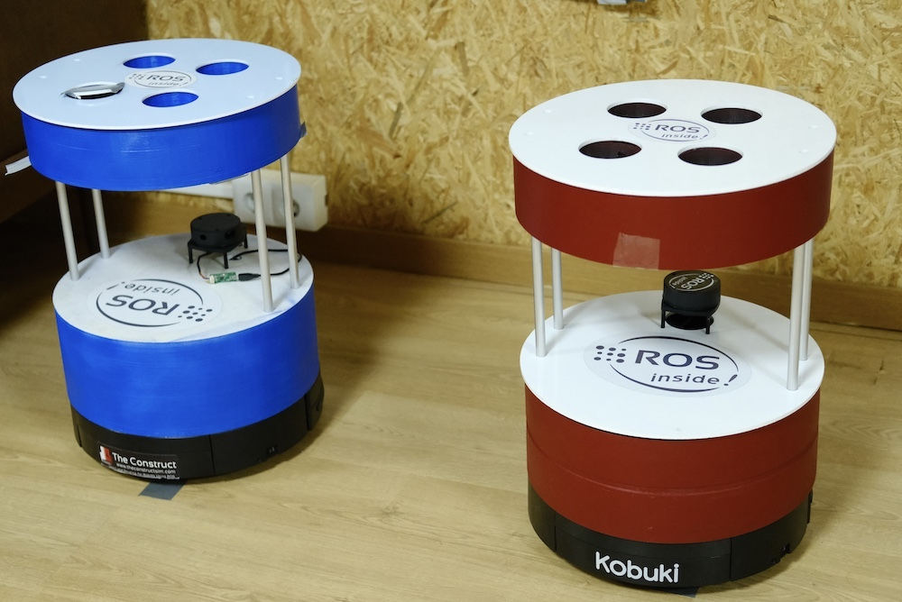

# Checkpoint 7 - URDF for ROS 2

Barista robot simulation built with **Xacro/URDF** and **Gazebo** on **ROS 2 (Humble)**. The model is a modular, parameterized description of a differential-drive coffee delivery robot with a cup holder tray, four standoff rods, a laser scanner, and support for spawning multiple robot instances with different identities (Rick and Morty).

Part of the [ROS & ROS 2 Developer Master Class](https://www.theconstructsim.com/) certification (Phase 1).

<p align="center">
  
</p>

## Robot Description

<p align="center">
  
</p>

| Component | Geometry | Dimensions | Mass |
|---|---|---|---|
| Body | Cylinder | 356 mm diameter, 155 mm height | 100 g |
| Drive wheels (x2) | Cylinder | 70.4 mm diameter, 20.6 mm width | 25 g each |
| Caster wheels (x2) | Sphere (3-axis) | Yaw + roll + pitch joints | - |
| Standoff rods (x4) | Cylinder | 20 mm diameter, 220 mm height | - |
| Cup holder tray | Cylinder | 320 mm diameter, 90 mm height | 50 g |
| Laser scanner | Hokuyo mesh | 32.7 mm radius | 50 g |

### Link Tree

```
base_link
  └── body_link (fixed)
        ├── left_wheel_link          (continuous)
        ├── right_wheel_link         (continuous)
        ├── front_caster_wheel       (yaw → roll → pitch, 3 continuous joints)
        ├── back_caster_wheel        (yaw → roll → pitch, 3 continuous joints)
        ├── standoff_rod_1..4_link   (fixed)
        ├── cup_holder_tray_link     (fixed)
        └── laser_scanner_link       (fixed)
              └── laser_scanner_frame (fixed)
```

## Tasks Breakdown

The project was developed incrementally across two tasks, each marked with a Git tag.

### Task 1 - Base URDF Model (`git checkout task1`)

- Created `barista_robot_model.urdf` with all links and joints matching the robot drawing dimensions
- Added body, drive wheels, caster wheels, standoff rods, cup holder tray, and laser scanner (Hokuyo mesh)
- Configured `libgazebo_ros_diff_drive.so` plugin publishing to `/odom` and subscribing to `/cmd_vel`
- Configured laser scanner plugin publishing to `/scan`
- Created `barista_urdf.launch.py` to spawn the robot in Gazebo + RViz
- Set up `.gitignore` to exclude the robot drawing image from the repo (`initial-tag`)

### Task 2 - Xacro Refactor (`git checkout task2`)

- Refactored the monolithic URDF into modular xacro macros (one per component)
- Added `include_laser` argument (default: `true`) with `xacro:if` conditional
- Added `robot_name` argument for multi-robot support with name-based colors and namespaces
- Created `barista_xacro.launch.py` to process xacro and spawn in Gazebo + RViz
- Created `barista_two_robots.launch.py` to spawn Rick (blue) and Morty (red) simultaneously

## Xacro Architecture

The URDF is fully modularized into reusable xacro macros:

| File | Macro | Description |
|---|---|---|
| `drive_wheel.xacro` | `drive_wheel` | Parameterized drive wheel (left/right) |
| `caster_wheel.xacro` | `caster_wheel` | 3-axis caster wheel (front/back) |
| `standoff_rod.xacro` | `standoff_rod` | Parameterized standoff rod (x4) |
| `cup_holder_tray.xacro` | `cup_holder_tray` | Top tray with robot-name-based color |
| `laser_scanner.xacro` | `laser_scanner` | Hokuyo lidar with mesh model |
| `model_plugins.xacro` | `state_publisher`, `differential_drive`, `laser_scanner_plugin` | Gazebo plugins with namespace support |
| `barista_robot_model.gazebo.xacro` | `gazebo_elements` | Gazebo materials and friction |
| `rviz_materials.xacro` | `rviz_materials` | RViz color definitions |

### Multi-Robot Support

The xacro accepts a `robot_name` argument that controls:
- **Colors**: `rick` / `barista_robot` → blue, `morty` → red
- **Namespaces**: plugins publish to `/<robot_name>/cmd_vel`, `/<robot_name>/odom`, `/<robot_name>/scan`
- **TF frames**: prefixed with `<robot_name>/` for multi-robot TF trees

## Gazebo Plugins

**Differential Drive** (`libgazebo_ros_diff_drive.so`)
- Wheel separation: 0.316 m, wheel diameter: 0.0704 m
- Publishes odometry + TF

**Joint State Publisher** (`libgazebo_ros_joint_state_publisher.so`)
- Publishes states for all 8 joints at 30 Hz

**Laser Scanner** (`libgazebo_ros_ray_sensor.so`)
- 200 samples, FOV: 180°, range: 0.1 - 5.0 m, update rate: 50 Hz
- Conditional: controlled by `include_laser` argument

## Project Structure

```
barista_robot_description/
├── CMakeLists.txt
├── package.xml
├── .gitignore
├── launch/
│   ├── barista_urdf.launch.py          # Single robot from static URDF
│   ├── barista_xacro.launch.py         # Single robot from xacro + Gazebo
│   └── barista_two_robots.launch.py    # Rick + Morty multi-robot
├── urdf/
│   └── barista_robot_model.urdf        # Static URDF (initial version)
├── xacro/
│   ├── barista_robot_model.urdf.xacro  # Main xacro (includes all macros)
│   ├── barista_robot_model.gazebo.xacro
│   ├── drive_wheel.xacro
│   ├── caster_wheel.xacro
│   ├── standoff_rod.xacro
│   ├── cup_holder_tray.xacro
│   ├── laser_scanner.xacro
│   ├── model_plugins.xacro
│   └── rviz_materials.xacro
├── meshes/                              # Hokuyo lidar 3D model
├── worlds/
├── rviz/
│   ├── barista_robot.rviz
│   └── barista_two_robots.rviz
└── media/
```

## How to Use

### Prerequisites

- ROS 2 Humble
- Gazebo Classic 11
- `gazebo_ros`, `robot_state_publisher`, `xacro`

### Build

```bash
cd ~/ros2_ws
colcon build --packages-select barista_robot_description
source install/setup.bash
```

### Single Robot

```bash
ros2 launch barista_robot_description barista_xacro.launch.py
```

### Two Robots (Rick and Morty)

```bash
ros2 launch barista_robot_description barista_two_robots.launch.py
```

Spawns Rick (blue) at origin and Morty (red) at (1.0, 1.0). Each has its own namespace, TF tree, and topics.

### Control a Robot

```bash
# Drive Rick
ros2 topic pub /rick/cmd_vel geometry_msgs/msg/Twist "{linear: {x: 0.2}, angular: {z: 0.0}}" -r 10

# Drive Morty
ros2 topic pub /morty/cmd_vel geometry_msgs/msg/Twist "{linear: {x: 0.2}, angular: {z: 0.5}}" -r 10
```

## Git Tags

| Tag | Description |
|---|---|
| `initial-tag` | Package skeleton with `.gitignore` excluding robot drawing image |
| `task1` | Complete URDF model with all links, joints, plugins, and launch file |
| `task2` | Xacro refactor with modular macros, conditional laser, multi-robot support |

## Key Concepts Covered

- **URDF modeling**: links, joints, visual/collision/inertial properties for ROS 2
- **Xacro macros**: parameterized, reusable robot component definitions
- **Conditional xacro**: `xacro:if` for robot-name-based colors and optional laser
- **Multi-robot spawning**: namespaces, TF frame prefixes, static transforms
- **Gazebo plugins**: diff drive, joint state publisher, ray sensor (all namespace-aware)
- **ROS 2 launch files**: Python-based launch with xacro processing via `Command`
- **Git practices**: `.gitignore` for binary files, meaningful commits, git tags as checkpoints

## Technologies

- ROS 2 Humble
- Gazebo Classic 11
- Xacro / URDF
- RViz2
